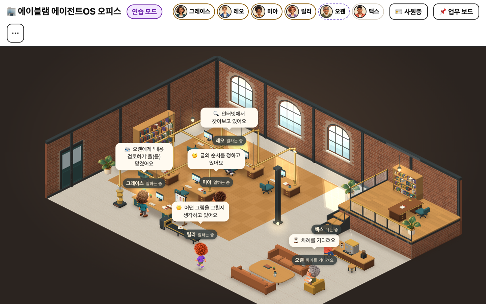

# 에이블램 에이전트OS 오피스

**AI 직원들이 일하는 작은 사무실입니다.** 대표님은 평소 말하듯 일을 부탁하고, 팀장 그레이스가 직원들에게 나눠 줍니다. 직원들의 말풍선과 진행 상황을 보다가 완성된 글·파일을 열어 볼 수 있습니다. 직원들은 실제 사람이 아닌 AI입니다.



Claude Code와 Codex에서 쓰는 플러그인입니다. 아이와 어르신이 사용할 때는 처음 설치와 계정 로그인만 도와주세요. 그 뒤에는 브라우저에서 사용합니다. AI 사용 요금과 한도는 연결한 Claude·OpenAI 계정의 조건을 따릅니다.

## 1. 처음 한 번 준비해 주세요

대표님, **Mac 또는 Windows PC**에서 평소 쓰는 AI 앱을 열어 주세요. 로그인되어 있다면 그대로 쓰시면 됩니다.

- **Codex 데스크탑 앱** 또는 **Claude 데스크탑 앱의 Code 화면** 중 하나를 사용합니다. 없다면 [Codex 앱 안내](https://developers.openai.com/codex/app/) / [Claude 앱 안내](https://code.claude.com/docs/en/desktop)를 따라 설치해 주세요.
- **Node.js 20 이상**이 필요합니다. 없으면 [Node.js 다운로드](https://nodejs.org/en/download)에서 **LTS**를 골라 설치 파일을 열고 안내대로 설치해 주세요. 끝나면 AI 앱을 완전히 껐다 다시 엽니다.
- **Git**이 없다는 안내가 나오면 [Mac 설치 안내](https://git-scm.com/download/mac) / [Windows 설치 안내](https://git-scm.com/download/win)를 도와주시는 분과 확인해 주세요. GitHub 계정은 필요 없습니다.

아래 과정은 앱 화면에서 진행합니다. 따로 명령을 복사해 실행하지 않습니다. 준비 여부는 오피스를 열 때 AI가 확인합니다.

## 2. 쓰는 AI 한쪽에 오피스 설치하기

**A 또는 B 중 한쪽만** 진행해 주세요. 버튼 이름과 위치는 앱의 버전·언어에 따라 조금 다를 수 있습니다.

### A. Claude 앱을 쓴다면

1. Claude 앱에서 **Code** 화면을 열고 **이 PC에서 실행하는 대화**를 선택합니다.
2. 입력창 옆 **+ → Add plugins**를 누릅니다. **Plugins**가 보이면 **Plugins → Browse plugins**를 누릅니다.
3. 마켓플레이스 추가 화면이 보이면 아래 주소를 넣습니다.

   ```text
   Andrew-Aparche/ablm-office
   ```

   **추가 화면이 없으면** 그 대화창에 아래 문장을 그대로 보내 주세요. Claude가 설치 명령을 실행해도 되는지 허락 창을 띄우면, 내용을 확인하고 **허용**을 누릅니다. 대표님이 다른 창을 열 필요는 없습니다.

   ```text
   에이블램 오피스 플러그인을 설치해 줘. 마켓플레이스는 Andrew-Aparche/ablm-office, 플러그인은 ablm-office@ablm-agent-os야.
   ```

4. **에이블램 에이전트OS 오피스**를 찾아 내용을 확인하고 **설치**를 누릅니다. 설치 범위는 대표님 계정으로 선택합니다.
5. **새 대화**를 열고 **에이블램 오피스 열어줘**라고 보내 주세요. 허락 창이 나오면 내용을 확인한 뒤 **허용**을 누릅니다.

Claude의 앱 내 플러그인 설치는 [공식 안내](https://code.claude.com/docs/en/desktop#install-plugins)에 있습니다. **이 오피스의 마켓플레이스 추가부터 첫 실행까지 앱에서 진행하는 과정(대화로 설치를 부탁하는 방법 포함)은 아직 실기 미검증**입니다. 일반 채팅·Cowork 화면과 Code 화면은 다릅니다.

### B. Codex 앱을 쓴다면

1. 앱의 **플러그인** 화면에서 **마켓플레이스 추가**를 선택하고 아래 주소를 넣습니다. 이미 추가했다면 이 단계는 건너뜁니다.

   ```text
   Andrew-Aparche/ablm-office
   ```

2. **에이블램 에이전트OS 오피스 → 설치**를 누릅니다. 설치 후 켜져 있는지도 확인합니다.
3. **새 대화**를 누릅니다. 방금 설치했던 대화에서는 새 기능이 아직 안 보일 수 있습니다.
4. **에이블램 오피스 열어줘**라고 보내 주세요. `/ablm-office`를 선택할 수 있으면 선택해도 됩니다.
5. 앱에 허락 창이 나오면 오피스 실행 내용인지 확인하고 **허용**을 누릅니다. **항상 허용**이 실제로 보일 때만, 이 오피스에 한정된 허락임을 확인한 뒤 선택하셔도 됩니다. 이번만 허용해도 됩니다.
6. 브라우저에서 오피스가 열리면 끝입니다. 자동으로 안 열리면 대화에 나온 전체 주소를 눌러 주세요.

한 번 더 실행 허락을 요청받으면 **이번만 허용**을 누릅니다. 연결 파일을 따로 실행할 필요는 없습니다. 허락 창 없이 막히면 **플러그인**에서 오피스를 확인하고 **새 대화**에서 다시 부탁해 주세요. 계속 막히면 오류 문구를 도와주시는 분께 보여 주세요.

[공식 안내](https://learn.chatgpt.com/docs/plugins)는 설치 후 새 대화를 권장합니다. **Windows 앱에서 이 오피스를 처음부터 끝까지 여는 과정은 아직 실기 미검증**이며, 조직에서 차단한 경우 담당자에게 문의해 주세요.

## 3. 회사 세우기 → 사원증 발급

1. 첫 화면의 **회사 세우기**에서 팀장 그레이스가 사용할 **Claude 또는 Codex**를 고르고 **이렇게 할게요 👍**를 누릅니다.
2. **사원증 발급 데스크**에서 팀장의 엔진에 **시작**을 누릅니다. 화면은 **점검 → 설치 → 서명(로그인) → 확인** 순서로 바뀝니다. 이미 준비된 프로그램과 로그인은 다시 만들지 않습니다.
3. 로그인 브라우저가 열리면 본인 계정으로 승인하고 오피스로 돌아옵니다. 이미 로그인됐는데 문제가 생겼다면 로그아웃하지 말고 **자세히 보기**를 도와주는 분께 보여 주세요.
4. 팀장의 사원증이 나오면 **🏢 사무실로 들어가기**를 누릅니다. 다른 엔진은 나중에 위쪽 **🪪 사원증**에서 준비해도 됩니다. 그 엔진 직원은 그동안 **입사 대기**로 보입니다.
5. 그레이스를 눌러 말해 보세요: **“레오에게 우리 동네 빵집 홍보 문구 3개를 맡기고, 홍보문구.md 파일로 만들어 주세요.”** 말풍선·작업 표시·결과물 카드·그레이스 보고를 차례로 확인합니다.

사원증의 마지막 **확인** 단계도 작은 AI 요청을 사용합니다. 설치·로그인·업무에는 인터넷 연결이 필요합니다.

## 4. 매일 열고 닫기

- 새 Claude/Codex 대화에서 **`/ablm-office`** 또는 **“에이블램 오피스 열어줘”**라고 말합니다.
- 오피스 위쪽 **⋯ 메뉴**에서 **🖥️ 바탕화면에 아이콘 만들기**를 한 번 누릅니다. 자동으로 만들지 않으므로 원할 때만 누르세요. 그 뒤 바탕화면의 **에이블램 오피스** 아이콘을 두 번 클릭하면 새 접속 주소로 열립니다. 브라우저 주소를 즐겨찾기로 저장해서 대신 사용하지 마세요.
- **휴대폰·태블릿으로 보기:** PC 오피스의 **⋯ 메뉴 → 📱 휴대폰으로 보기 → 휴대폰 연결 켜기**를 누르고, 나온 QR 코드를 휴대폰 카메라로 찍습니다. 휴대폰은 PC와 **같은 와이파이**에 있어야 합니다. 처음 켤 때 방화벽 창이 나오면 **허용**을 누릅니다. 다 쓰면 **휴대폰 연결 끄기**(2시간 동안 안 쓰면 저절로 꺼짐). 사원증 발급은 PC에서만 합니다.
- 업무 하나를 멈추려면 직원 화면의 **그만!**, 프로젝트 전체를 멈추려면 프로젝트 중단 버튼을 누릅니다.
- 서버까지 닫으려면 Claude/Codex에 **“오피스 닫아줘”**라고 말합니다. 브라우저 탭만 닫으면 서버와 작업은 계속될 수 있습니다.

## 5. 잘 안 될 때

| 보이는 상황 | 이렇게 해 주세요 |
|---|---|
| `401` 또는 “다시 열어주세요” | `/ablm-office`나 바탕화면 아이콘으로 다시 엽니다. 서버를 다시 켜면 예전 접속 주소가 만료됩니다. |
| 브라우저가 안 열림 | 대화에 표시된 **`http://127.0.0.1:숫자/?t=...` 전체 주소**를 복사해 같은 PC의 브라우저에 붙여 넣습니다. `?t=` 뒤를 자르지 않습니다. |
| 주소가 열린 뒤 `?t=`가 사라짐 | 정상입니다. 브라우저가 접속 쿠키를 받은 뒤 주소에서 토큰을 지웁니다. |
| 직원이 **입사 대기** | 위쪽 **🪪 사원증**에서 해당 엔진의 **시작**을 누릅니다. 로그인 승인 후 확인까지 끝내세요. |
| 휴대폰에서 QR 주소가 안 열림 | 휴대폰과 PC가 같은 와이파이인지, 방화벽 창에서 **허용**했는지 확인합니다. 학교·카페·회사 공용 와이파이는 기기끼리 연결을 막는 경우가 많아 안 될 수 있습니다(집 공유기나 휴대폰 핫스팟으로 시도). |
| 휴대폰에 “QR 코드를 다시 찍어 주세요” | 휴대폰 연결이 꺼졌거나 서버가 다시 시작됐습니다. PC에서 다시 켜고 새 QR을 찍습니다. |
| `/ablm-office`가 안 보임 | 설치한 앱에서 **새 대화**를 열고 **에이블램 오피스 열어줘**라고 보내 주세요. |
| `node`를 찾을 수 없음 | Node.js LTS 설치 후 Claude/Codex 앱을 완전히 닫았다 다시 엽니다. |
| 그 밖의 오류 | **자세히 보기**의 문구와 문제 시각을 전달합니다. 접속 토큰·로그인 코드·인증 파일은 가리고 보내세요. |

## 6. 자료와 권한

결과물은 Mac의 `~/AblmOffice/workspace`, Windows의 `%USERPROFILE%\AblmOffice\workspace`에 저장됩니다. 중요한 원본 대신 복사본으로 시작하세요.

오피스는 이 PC의 `127.0.0.1`에서 열립니다. 접속 주소의 토큰은 오피스를 여는 열쇠이므로 공유하지 않습니다. 로컬 오피스여도 요청한 글과 업무 자료는 연결한 AI 제공자에게 전송될 수 있습니다.

기본 Claude 직원은 파일·검색 도구만 쓰고 **셸(Bash) 명령은 차단**합니다. Codex 직원은 전용 작업 폴더를 작업 위치로 삼아 샌드박스에서 실행하며, 팀장은 읽기 전용입니다. 이는 PC 전체에 대한 완전한 격리를 보장한다는 뜻은 아닙니다. 보안 설정을 낮추거나 전체 디스크·임의 명령 허용을 켜지 마세요.

## 7. 지우기

먼저 앱 대화에서 **오피스 닫아줘**라고 말해 주세요. 그다음 설치한 앱의 **플러그인** 화면에서 오피스를 선택하고 **제거**를 누릅니다. 조직에서 설치한 항목이라 제거 버튼이 없으면 담당자에게 문의해 주세요.

예전 안내로 별도 연결을 해 두신 분은 도와주시는 분께 남은 연결도 정리해 달라고 부탁해 주세요. 로그인은 지울 필요가 없습니다.

바탕화면의 오피스 아이콘은 직접 휴지통으로 옮깁니다. 결과물은 `AblmOffice`에 남습니다. 필요하다면 먼저 백업하고, 자료까지 지울 때만 그 폴더를 직접 삭제해 주세요.

## 라이선스

이 플러그인은 오픈소스가 아닙니다. 개인이 자신의 컴퓨터에 설치해 사용할 수 있으며, 복제·재배포·판매·수정·역설계는 허락 없이 할 수 없습니다. 자세한 내용은 [LICENSE](LICENSE)를 참고하세요.
